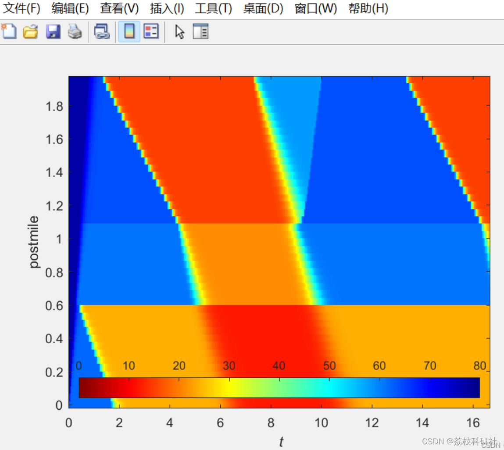
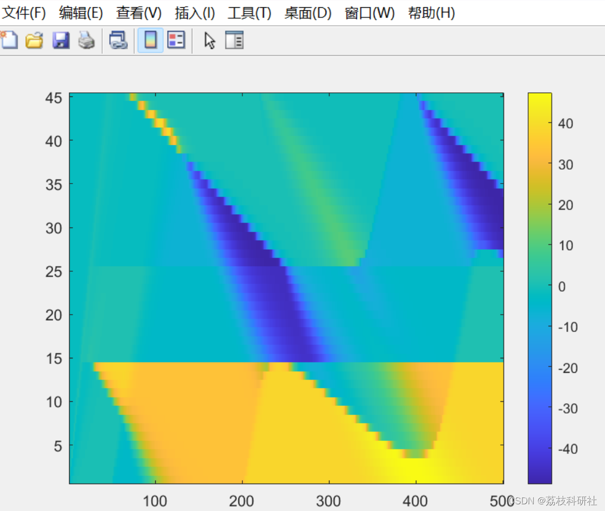
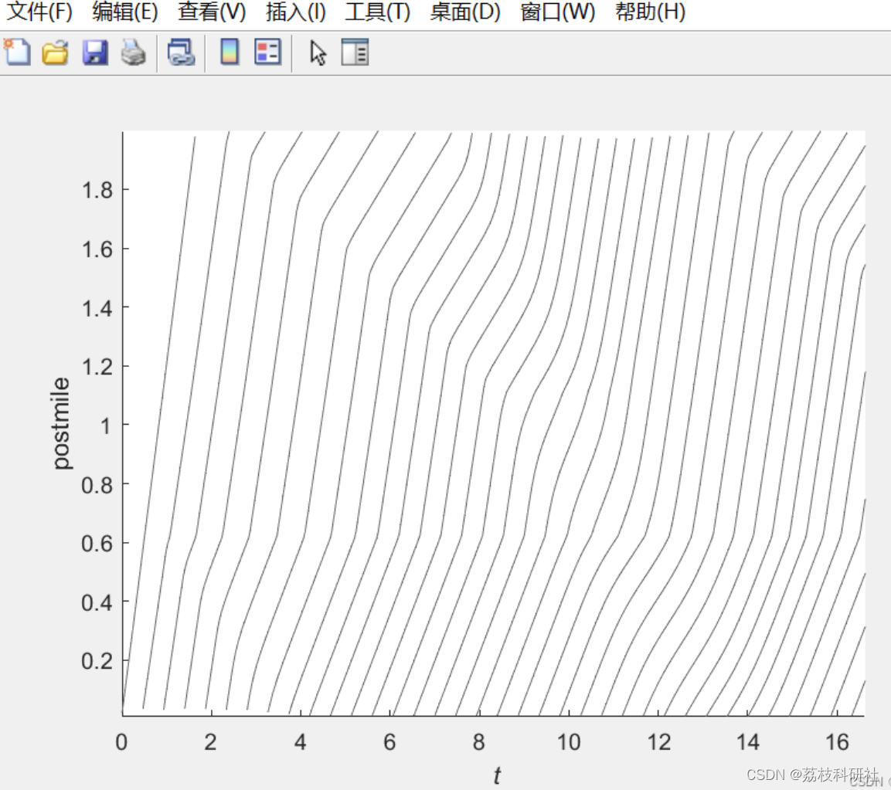
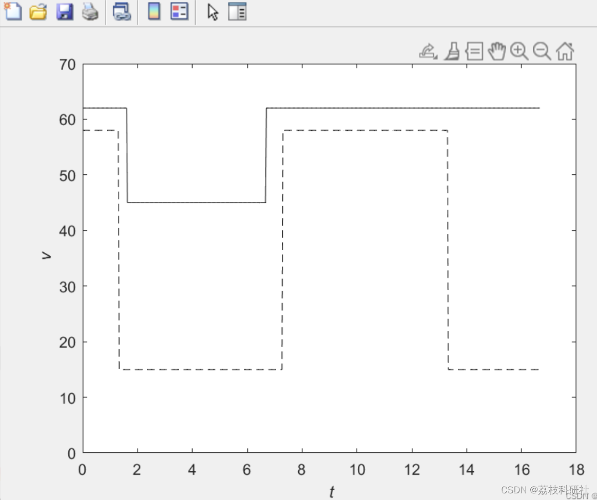

# [z] Inverse Traffic Modeling Based on MCMC (Matlab Code Implementation)

​  
📚2 Running Results Editing
Editor
Editor
Editor
Part of the code:
%this code simulates the true state  
%used in the article simulations. It models the vehicle trajectories  
%using the algorithm 2 in the article  
close all  
clear all  
%set true state  
deltaT=2/3600;  
vmax=77;  
rhomax=[180*5,170*4,160*5];  
wf=16;  
vmaxForMesh=80;  
deltaX=deltaT*vmaxForMesh;  
domainLengthInmiles=2;  
numCells=domainLengthInmiles/deltaX;  
timeSteps=500  
vInitial=77*ones(numCells,1);  
%% plot boundary conditions  
figure  
vUpstream=62*ones(timeSteps+1,1);  
vUpstream(50:end-300)=45;  
vDownstream=15*ones(timeSteps+1,1);  
vDownstream(1:40)=58;  
vDownstream(220:400)=58;  
timeDisc=(0:deltaT:timeSteps*deltaT);  
plot(timeDisc*60,vUpstream,'k -')  
hold on  
plot(timeDisc*60,vDownstream,'k --')  
ylabel('\it v')  
xlabel('\it t')  
%legend('upstream','downstream')  
set(gca,'Ylim',[0 70])  
set(gcf, 'PaperUnits', 'inches');  
papersize=[3 3];  
set(gcf, 'PaperSize',papersize);  
width=2.5;  
height=2.5;  
left=(papersize(1)-width)/2;  
bottom=(papersize(2)-height)/2;  
myfiguresize = [left,bottom,width,height];  
set(gcf, 'PaperPosition', myfiguresize);  
print('-dpsc2','figs/trueBoundaryConditions.eps')  
system('epstopdf figs/trueBoundaryConditions.eps')  
%axis tight  
%% simulate v-field with CFL=0.5  
numLanes=1*ones(size(vInitial));  
numLanes(15:25)=1;  
numLanes = [numLanes(1); numLanes; numLanes(end)];  
dropLocation = (15:25);  
rhoMaxVec = zeros(numCells, 1);  
rhoMaxVec(dropLocation) = rhomax(2);  
rhoMaxVec(1:dropLocation(1)-1) = rhomax(1);  
rhoMaxVec(dropLocation(end)+1:end) = rhomax(3);  
rhoMaxVec = [rhoMaxVec(1); rhoMaxVec; rhoMaxVec(end)];  
rhoCritVec = rhoMaxVec .* (wf / vmax);  
vupdated = updatevHalfCFL(vInitial, deltaX, deltaT, timeSteps, vDownstream, vUpstream, rhoCritVec, vmax, wf * ones(numCells + 2, 1), rhoMaxVec, numLanes);  

# Matlab code for the above implementation
```

## Images







<!-- PAYMENT_BLOCK -->

## Get this dataset

- Payment link (Stripe): [Buy now](https://buy.stripe.com/3cs8yP7sY87d0vu9AB)
- Payment QR code: 

<!-- /PAYMENT_BLOCK -->
